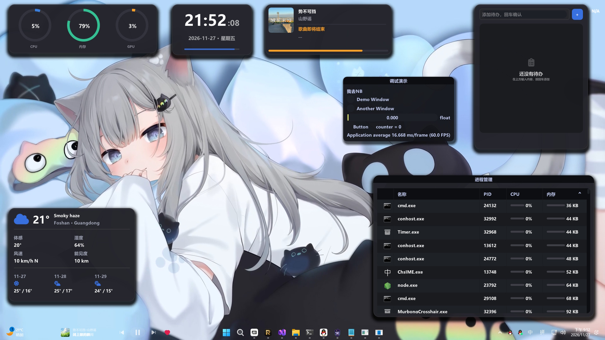
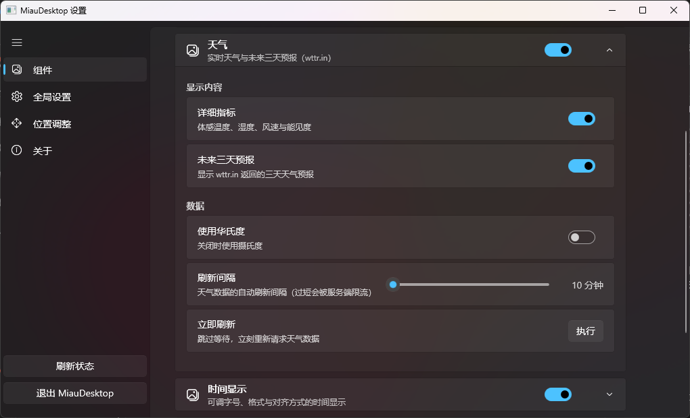

#### 项目介绍
readme暂时没时间细写，简单说一下吧。
本项目正在开发中，已经初步可用，但是使用体验仍然需要优化。

# MiauDesktop - 猫猫桌面
### 一个华丽桌面组件项目，追求轻量、实用、美观、功能强大

# 图片

# 项目结构

MiauDesktop：桌面组件的主程序。
MiauSettings：设置UI，也就是设置界面。

设置界面和主程序使用管道通信，使用体验目前有点差。

# 关于项目的开发

本项目部分使用AI开发。
整个项目的底层框架由本人手动编写（AI仅辅助提供建议）。
在框架、功能、UI封装成熟后，本人使用了AI直接开发组件代码，让AI通过我暴露的接口进行开发组件。
这样可以尽可能的使AI编写的代码规范化，虽然后期就变成了Vibecoding项目，但是我认为只要不是让AI去更改框架，都是可以接受的，
后期的项目我只需要耐心、仔细的去review，或者手动更改部分必要、重要代码。
除了项目的GuiBase大部分是由AI参考EUI-NEO进行编写，本人编写了部分复杂代码和进行AI编写的方向控制，项目UI大量参考了EUI-NEO，对此鸣谢。
ps：因为我的UI审美不太好，自己设计的UI框架难看的一批。

