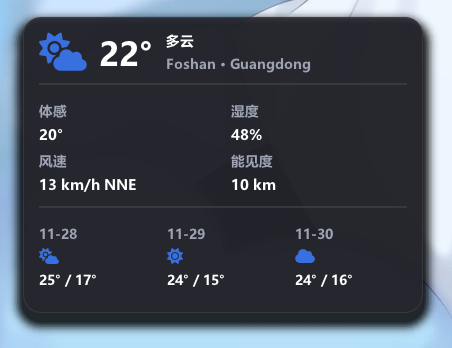
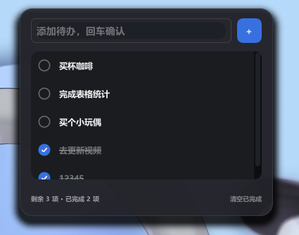
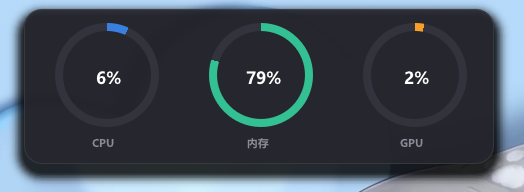
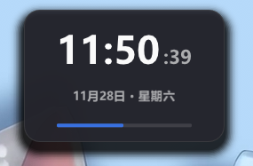
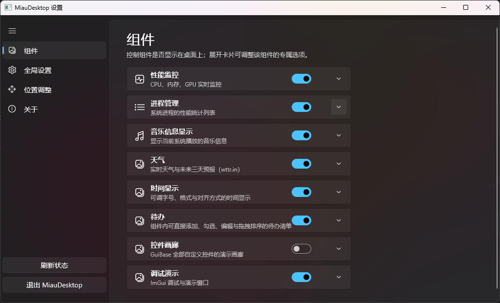

<div align="center">

<span style="font-size:2.4em;font-weight:bold;">MiauDesktop · 猫猫桌面</span>

**一个开源桌面组件项目，追求轻量、实用、美观、功能强大。**

---

基于 **Dear ImGui + DirectX 11** 的 Windows 桌面组件框架：**独立**且**支持半透明**的卡片式小部件，<br/>
同时加上一个独立的 **WinUI 3 设置中心**。

<p align="center">
  </a>
  <a href="LICENSE"></a>
  
  
  
  <a href="https://github.com/COM1919/MiauDesktop/stargazers"></a>
</p>


<sub>桌面背景为个人设置，并非组件绘画<br/>组件渲染完全支持透明度，只不过在截图的demo中，我使用的是默认不透明组件</sub>

</div>

---

## 📖 简介

*MiauDesktop* 是一个**桌面挂件（Widget）框架**项目：主程序把无边框窗口贴在桌面上，绘制一张张卡片，实时显示你关心的信息——性能、音乐、天气、时间、待办等等...

它是一个包含一套自研的 UI 基础设施的项目：

- **GuiBase** —— 参考 [EUI-NEO](https://github.com/sudoevolve/EUI-NEO) 打造的自绘控件库（主题令牌、阴影、Card、图表、导航、抽屉、滚动视图、虚拟列表、瀑布流、Markdown……）。<br/>底层是基于 [ImGui](https://github.com/ocornut/imgui) 的渲染后端，使用了 ImGui 的 DrawList 和部分内置控件；
- **Component 框架** —— 抽象基类 + 配置绑定 + 设置项数据驱动，新增组件只需要继承与注册，<br/>它让组件的开发变得异常简单，新手也能快速创建一个属于自己的组件；
- **独立设置中心** —— WinUI 3 程序通过命名管道与主程序通信，主程序增加设置项时**无需修改设置程序**，无须时就不启动，节约开销。

### 计划开发：未来将实现 **灵动岛**、**桌面宠物**、**壁纸引擎**、**课表组件**、**闹钟组件**。

我们不仅仅接受项目修复BUG的PR，也可以是新增组件、功能。
目前暂时没有详细规定PR规则，所以PR的限制比较宽松，欢迎 Issue / PR。

> 项目仍在持续开发中，已初步可用，但使用体验仍在打磨。
> 所以项目还没有图标和Logo。

---

## ✨ 功能亮点 / 设计目标

|特性 | 说明 |
| --- | --- |
| **UI美观** | 在UI设计上尽可能的实现优秀，好的UI才能让心情好，不单单是功能好用。 |
| **实用** | 以用户的角度去设计UI，追求不用时毫不打扰。 |
| **高度自定义** | 允许开发各种组件并装载到MiauDesktop中，丰富接口 |

## 🖼️ 截图

<table>
<tr>
<td align="center" width="50%"></td>
<td align="center" width="50%"></td>
</tr>
<tr>
<td align="center" width="50%"></td>
<td align="center" width="50%"></td>
</tr>
<tr>
<td align="center" width="50%"></td>
<td align="center" width="50%"></td>
</tr>
</table>

---

## 🚀 快速开始

### 运行与使用

1. 双击 `MiauDesktop.exe`，桌面会出现组件卡片，托盘区出现图标。
2. **右键托盘图标 → 设置**，打开 MiauSettings：
   - **组件**：开关组件、展开卡片调整专属参数；
   - **全局设置**：动画开关、速度与缓动曲线；
   - **位置调整**：进入编辑模式，在桌面上拖动、缩放组件，带对齐线与吸附；
   - **关于**：版本与项目信息。
3. 退出：托盘右键 → **退出**，或设置程序左下角「退出 MiauDesktop」。

> [!WARNING]
> **主程序** 和 **设置程序** 需要在同一目录。

### 系统要求

- **Windows 10** 及以上
- **Visual Studio 2026**，安装以下工作负载：
  - 「使用 C++ 的桌面开发」（MSVC v145、Windows SDK）
  - 「Windows 应用程序开发」（C++/WinRT、WinUI 3 / Windows App SDK 模板）
- 首次构建需要联网还原 NuGet 包（Windows App SDK 2.6.5 - 用于 WinUI3 的开发）

### 克隆与构建

> [!INFO]
> 后续会支持cmake编译，但目前的计划是不打算做成跨平台项目<br/>
> 因为本人没有linux设备、跨平台开发经验很少，就暂时不打算跨平台了<br/>
> 但我也会尽可能的避免过多的 Windows API 的使用

```powershell
git clone https://github.com/COM1919/MiauDesktop.git
cd MiauDesktop

# 在 “Developer PowerShell for VS” 中执行
msbuild MiauDesktop.slnx /restore /p:Configuration=Debug /p:Platform=x64 /m
```

也可以直接用 Visual Studio 打开 `MiauDesktop.slnx`，点击生成解决方案。

构建产物统一输出到：

```text
srv\bin\x64\Debug\
├── MiauDesktop.exe      # 主程序
└── MiauSettings.exe     # 设置程序
```

> Debug 构建默认开启 `MD_DEBUG`（见 `srv/MiauDesktop/MainGUI.h`）：会附带调试控制台、窗口置顶（方便看 UI），并注册控件画廊与 Debug Demo。

---

## 📂 项目结构

```text
MiauDesktop/
├─ MiauDesktop.slnx              # 解决方案（VS 2026 / XML 格式）
├─ srv/
│  ├─ MiauDesktop/               # 主程序：ImGui + DX11 + DComp
│  │  ├─ MainGUI.cpp / .h        # 入口、窗口、渲染循环、组件注册
│  │  ├─ Component.cpp / .h      # 组件基类 + ComponentManager + 编辑模式
│  │  ├─ Components/             # 内置桌面组件
│  │  ├─ GuiBase/                # 自绘控件库（主题 / 动画 / Card / 图表 / 导航…）
│  │  ├─ AppSettings/            # 托盘、位置调整、全局设置
│  │  ├─ Settings/               # 命名管道服务端
│  │  ├─ Config/                 # 树形配置系统
│  │  ├─ ImGui/                  # Dear ImGui 及第三方扩展
│  │  ├─ PicoJson/ Stb/          # 第三方单头库
│  │  └─ MiauDesktop.vcxproj
│  ├─ MiauSettings/              # WinUI 3 设置程序（C++/WinRT）
│  ├─ Shared/
│  │  └─ SettingsProtocol.h      # 主程序 ↔ 设置程序通信协议
│  └─ bin/                       # 构建输出（已 gitignore）
├─ docs/                         # 截图与项目分析文档
└─ README.md
```

---

## 🧑‍💻 开发自己的组件 / 添加组件

很简单的啦~，新增一个组件只需要三步：继承、实现、注册。

```cpp
// srv/MiauDesktop/Components/HelloCard.h
#pragma once
 // 基本头文件，可不包含
#include "../Framework.h"
// 组件管理器头文件，必须包含，其中已经包含了BaseGui头文件，只需要包含这个就可以使用大部分接口。
#include "../Component.h"

class HelloCard : public Component {
public:
    HelloCard() : Component("Hello") { // 构造函数，在这里初始化控件所需的一切
        SetWindowSize(ImVec2(280.0f, 140.0f)); // 设置窗口的初始化大小
        // 添加配置项 / 设置选项，会在MiauSettings中显示这些信息。
        config.AddItem("Greeting", std::string("喵~")); // 配置项会自动挂在 "Hello" 根节点下，无需拼接路径
    }
    const char* GetIcon()        const override { return ICON_FA_CAT;   } // 定义组件的图标
    const char* GetDescription() const override { return "一个示例组件"; } // 定义组价的描述
    void OnLoadConfig() override { // 处理加载配置
        m_greeting = config.Get<std::string>("Greeting");
    }
    void OnSaveConfig() override { // 处理保存配置
        config.Set("Greeting", m_greeting);
    }
protected:
    void ComponentRender() override { // 组件内容的渲染代码
        ImGui::TextUnformatted(m_greeting.c_str());
        // 可调用ImGui渲染代码和控件，也可以调用BaseGui封装的控件。
        // 因为BaseGui本身就是基于ImGui的封装。
    }
private:
    std::string m_greeting = "喵呜";
};
```

然后在 `srv/MiauDesktop/MainGUI.cpp` 的组件注册处添加：

```cpp
g_compManager.AddComponent(std::make_unique<Components::HelloCard>()); // 注册HelloCard组件
```

如果希望组件在 WinUI 设置程序中拥有专属参数面板，可以重写 `CollectSettings()` 并推送
`Slider / Toggle / Choice / Action` 等 `SettingItem` 即可——设置程序无需任何改动。

> [!INFO]
> 注：还未实现插件管理器，目前不支持装载插件，只能通过修改源代码来添加组件。
> 后续考虑采用 `DLL(动态链接库)` 形式的插件装载。


---

## 🧱 技术栈

| 方面 | 描述 |
| --- | --- |
| 语言 | C++20（`/utf-8`） |
| 渲染 | Dear ImGui + DirectX 11 |
| 窗口合成 | DirectComposition（逐像素透明） |
| 系统能力 | Win32、WinRT（媒体会话）、PDH、PSAPI、iphlpapi、WinHTTP |
| 设置界面 | WinUI 3 / Windows App SDK 2.6 + C++/WinRT |
| 使用的图标 | Font Awesome 6 |
| 其他ImGui组件 | ImPlot / ImPlot3D、imgui_md、imgui_toggle、TextEditor、stb |

---

## ⚠️ 项目现状与已知限制

- 项目仍在开发中，功能可用但部分交互体验尚待优化。
- 一些使用体验仍有改进空间。
- 窗口字体固定读取 `C:\Windows\Fonts\msyhbd.ttc`（微软雅黑粗体），后续考虑自定义字体和动态获取。
- 源码默认开启 `MD_DEBUG`：包含调试控制台、窗口置顶、控件画廊与 Debug Demo。

*注：理论上 Windows 7 也可以使用，但我并没有实际测试过。*

---

## 🙏 致谢

- [Dear ImGui](https://github.com/ocornut/imgui) —— 非常好用的 C++ UI 库，虽然是**立即模式**的渲染。
- [EUI-NEO](https://github.com/sudoevolve/EUI-NEO) —— GuiBase 的视觉与控件设计大量参考该项目，包括灵感也是来源这里。
- [ImPlot](https://github.com/epezent/implot) / [ImPlot3D](https://github.com/brenocq/implot3d)
- [imgui_md](https://github.com/mekhontsev/imgui_md)、[imgui_toggle](https://github.com/cmdwtf/imgui_toggle)、[TextEditor](https://github.com/BalazsJako/ImGuiColorTextEdit)
- [Font Awesome](https://fontawesome.com/)、[stb](https://github.com/nothings/stb)、[PicoJSON](https://github.com/kazuho/picojson)
- [wttr.in](https://wttr.in) —— 免费的天气查询

### 关于开发方式

本项目部分使用 AI 辅助开发：

- 最初，整个底层框架为古法编程，后续陆续引入AI辅助（其实是网页版AI）；
- 框架、功能与 UI 封装成熟后，组件代码交由 AI 基于已暴露的接口开发，以保持代码规范；
- 项目后期接近 “Vibecoding”，但框架部分始终由人工把控（我可不相信大肥鱼写的代码不会有BUGs）；
- 在项目后期时，GuiBase 的代码大部分由 AI 参考 EUI-NEO 而编写的，我只是负责一个一个测试和指导方向。

---

<div align="center">

**如果这个项目让你桌面变好看了，点个 ⭐ Star 吧！**

**喵呜~~~~**

</div>