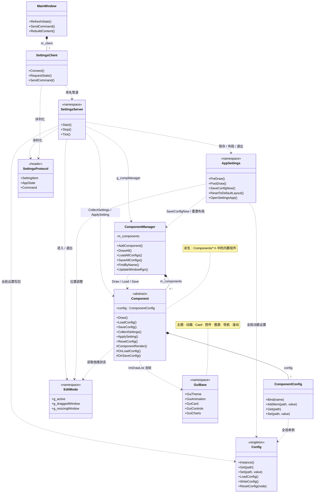
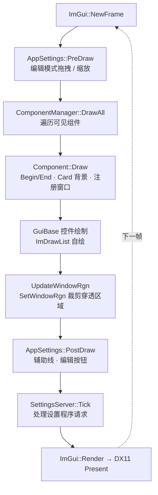
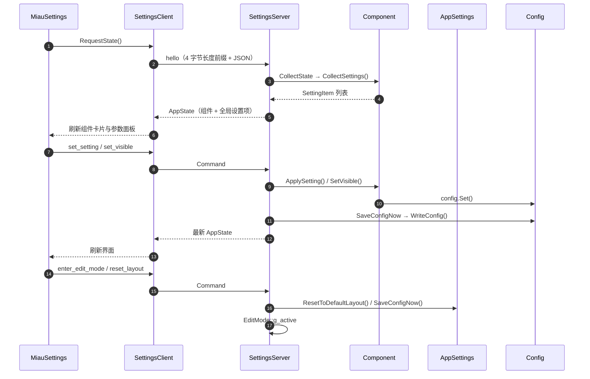

## 🏗️ 架构

核心类与模块关系：

- **渲染层**：Win32 无边框窗口 → DirectX 11 → DirectComposition，实现逐像素透明；ImGui 负责所有绘制。
- **组件层**：每个组件是一个 `Component` 派生类，自己绘制内容、声明配置项；`ComponentManager` 统一加载/保存配置、分发绘制。
- **设置层**：主程序把设置项序列化为 `SettingItem`，设置程序渲染后回传命令；协议只共享数据结构与收发逻辑，不含业务代码。

每帧的调用顺序：

设置程序与主程序之间的数据往返：

